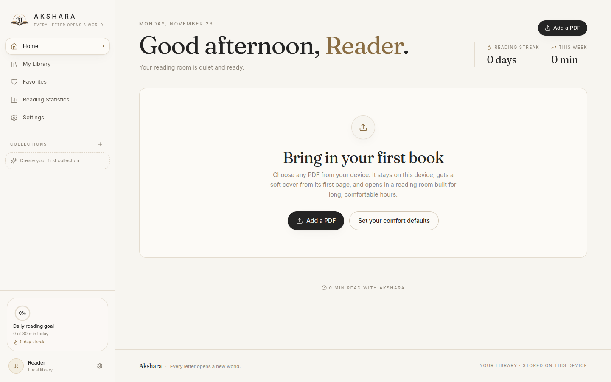

# Akshara (अक्षर)

**Every letter opens a new world.**

[](https://github.com/Peritoooo/akshara/actions/workflows/ci.yml)
[](https://github.com/Peritoooo/akshara/releases/latest)
[](https://peritoooo.github.io/akshara/)
[](LICENSE)


A calm, local-first **desktop PDF reader**. Import your own books, read them in a
quiet window that follows your theme, and keep your place. No catalog, no feed,
no recommendations — just the books you chose.

**Your PDFs never leave your computer.** An optional account can sync your
reading progress, highlights, and notes between machines; the files themselves
stay where you imported them.

## Download

Get the latest installer from
[**Releases**](https://github.com/Peritoooo/akshara/releases/latest).

| Platform | File | How to install |
| --- | --- | --- |
| Windows 10/11 | `Akshara-*-setup.exe` | Run the installer |
| macOS (Apple silicon) | `Akshara-*-arm64.dmg` | Open, drag to Applications |
| macOS (Intel) | `Akshara-*-x64.dmg` | Open, drag to Applications |
| Linux (recommended) | `Akshara-*-x86_64.AppImage` | Make executable, run |
| Linux (Debian/Ubuntu) | `akshara_*_amd64.deb` | `sudo apt install ./file.deb` |

### Windows

1. Download `Akshara-*-setup.exe` and run it.
2. If **Windows protected your PC** appears, click **More info → Run anyway**.
   The build is unsigned for now.
3. Launch Akshara from the Start menu.

### macOS

1. Download the `.dmg` that matches your Mac: **arm64** for Apple silicon
   (M1/M2/M3/M4), **x64** for Intel.
2. Open it and drag **Akshara** into **Applications**.
3. The first time, **right-click the app → Open** instead of double-clicking.
   The build is unsigned, so macOS asks for this once.

If macOS says the app is damaged, remove the quarantine flag:

```bash
xattr -dr com.apple.quarantine /Applications/Akshara.app
```

### Linux

The **AppImage** is recommended because it updates itself.

```bash
chmod +x Akshara-*-x86_64.AppImage
./Akshara-*-x86_64.AppImage
```

On Ubuntu 24.04+ install FUSE 2 first:

```bash
sudo apt install libfuse2t64
```

Prefer a system package? Use the `.deb`:

```bash
sudo apt install ./akshara_*_amd64.deb
```

The `.deb` updates through `apt`; the AppImage updates itself.

### Requirements

- Windows 10 or 11 (64-bit)
- macOS 11 Big Sur or newer (Intel or Apple silicon)
- Linux x86_64: Ubuntu 20.04+, Debian 11+, Fedora 36+, or similar
- About 250 MB of disk space, plus your books

## Your first five minutes

1. **Add a book.** Open **Home** or **Library** and choose **Add a PDF**. The
   file is copied into Akshara's local storage, so you can move or delete the
   original afterwards.
2. **Read.** Arrow keys turn pages. Press **F** for a distraction-free window,
   **T** for the table of contents, and **S** to change the reading theme or
   text size.
3. **Mark what matters.** Select text to highlight it or attach a note. Press
   **B** to bookmark a page.
4. **Pick up later.** Your place is saved automatically, even offline.

An account is optional. If you want your progress and highlights on another
computer, create one under **Settings → Account**.

## Screenshots

| Home | Library | Reader |
| --- | --- | --- |
|  |  |  |

## What's inside

**Reading**
- Themed reader with light, sepia, and dark reading modes
- Page, width, and custom zoom; single-page or spread layout
- Table of contents, bookmarks, and keyboard-first navigation
- Text selection with persistent highlights and notes

**Library**
- Import your own PDFs; a cover is made from the first page
- Collections, reading statuses, favorites, search, and filters
- Reading statistics and a daily reading goal

**Your data**
- Works fully offline: library, reader, notes, and progress
- Optional account syncs metadata only — never PDF files
- Password reset, in-app password change, and permanent account deletion
- Export a JSON copy of your metadata at any time

**Desktop**
- Native installers for Windows, macOS, and Linux
- Automatic updates on Windows and the Linux AppImage
- Follows your system light/dark theme

## Keyboard shortcuts

These work while reading, as long as you are not typing in a note.

| Key | Action |
| --- | --- |
| `←` / `→` | Previous / next page |
| `F` | Toggle focus mode |
| `T` | Table of contents |
| `B` | Add or remove a bookmark |
| `S` | Reading appearance |
| `+` / `−` | Text size |
| `?` | Show all shortcuts |
| `Esc` | Close panels or leave focus mode |

## Privacy in plain language

- **No analytics, no telemetry, no ads.**
- **PDFs stay on your device.** They are stored locally and never uploaded.
- **An account is optional.** Without one, nothing leaves your computer.
- **With an account, only reading metadata syncs** — progress, positions,
  highlights, notes, bookmarks, collections, and preferences.
- **You can delete everything.** **Settings → Delete account** removes your
  synced data and the local library from that device. It cannot be undone.

| Synced to your account | Stays on the device |
| --- | --- |
| Book metadata (title, author, cover thumbnail) | **The PDF file itself** |
| Library entries, status, progress | Device appearance theme |
| Reading positions | |
| Highlights, notes, bookmarks | |
| Collections and memberships | |
| Reading sessions | |
| Display name, daily goal, reader preferences | |

The Supabase `anon` key ships in the client by design; row-level security is what
protects each account. No `service_role` key is ever bundled.

## Updates

- **Windows and Linux AppImage:** Akshara checks quietly after launch and
  downloads updates in the background. **Help → Check for Updates…** checks
  immediately and offers to restart.
- **Linux `.deb`:** updates come from your package manager. The menu item opens
  the release page.
- **macOS:** the same flow, but installing an update requires a signed build.
  Current builds are unsigned, so macOS points you at the release page instead.
- **Settings → Updates** always shows the running version and a
  **Check for updates** button.

## Troubleshooting

**Windows shows “Windows protected your PC.”**
Click **More info → Run anyway**. The installer is unsigned, so SmartScreen
cannot verify the publisher yet.

**macOS refuses to open the app.**
Right-click **Akshara** in Applications and choose **Open** once. If it says the
app is damaged, run the `xattr` command above.

**The AppImage won't start on Ubuntu 24.04.**
It needs FUSE 2: `sudo apt install libfuse2t64`. Or use the `.deb`.

**Where are my books stored?**
Inside the app's profile, not next to the original files:

- Linux: `~/.config/akshara`
- Windows: `%APPDATA%\akshara`
- macOS: `~/Library/Application Support/akshara`

**How do I back up my library?**
**Settings → Export copy** saves your metadata as JSON, but **not the PDFs**.
Keep your original PDF files; if the profile is lost, re-import them and the
metadata can be restored. A full backup that includes the files is planned.

**Do I need an account?**
No. Everything except cross-device sync works signed out.

**I didn't get the confirmation email.**
Check your spam folder first. If it still doesn't arrive, keep using Akshara
without an account — reading, highlights, and notes all work signed out.

**Does it work offline?**
Yes. Reading, notes, and progress work without a connection. Changes made offline
sync when the connection returns.

**Can I read EPUB files?**
Not yet. Akshara 1.0 imports PDFs only; EPUB support is in progress.

**Can I search inside a book?**
Not yet. Library search works; in-book search is the next major reader feature.

**How do I uninstall?**
- Windows: **Settings → Apps → Akshara → Uninstall**.
- macOS: move **Akshara** from Applications to the Trash.
- Linux: delete the AppImage, or `sudo apt remove akshara`.

The profile folder above is separate. Delete it only if you also want to remove
your library and settings.

## For developers

### Getting started

Requirements: Node 20+.

```bash
npm install
npm run app:start   # build + launch the desktop app
```

`npm run dev` runs the Vite UI in a browser for fast interface work. The shipped
product is the Electron app.

### Scripts

| Command | What it does |
| --- | --- |
| `npm run app:start` | Build and launch the desktop app |
| `npm run app:dist` | Build Linux `.deb` + AppImage into `release/` |
| `npm run app:dist:win` | Build the Windows installer |
| `npm run app:dist:mac` | Build the macOS dmg/zip |
| `npm run test:smoke` | Browser UI suite |
| `npm run test:e2e` | Real Electron shell suite |
| `npm test` | Both suites |
| `npx tsc -b` | Typecheck |

### Accounts and sync (optional)

Sync is off unless a Supabase project is configured at build time, so a plain
local build works with zero backend.

1. Create a project at [supabase.com](https://supabase.com).
2. Apply the schema. Either connect the project to this repository
   (**Project Settings → Integrations → GitHub**, deploy from `main`) or paste
   `supabase/migrations/*.sql` into the SQL Editor in filename order.
3. Copy **Project Settings → API → Project URL** and the **anon public** key into
   `.env.local`:

   ```bash
   VITE_SUPABASE_URL=https://your-project-ref.supabase.co
   VITE_SUPABASE_ANON_KEY=eyJhbGciOi...
   ```

4. Under **Authentication → URL Configuration**, set the Site URL to any valid
   `https://` address (for example `https://example.com`) and add these redirect
   URLs:

   - `akshara://auth/recovery` — password reset
   - `akshara://auth/callback` — email confirmation
   - `http://localhost:5173` — only for `npm run dev`

5. Email delivery: connect a transactional provider under
   **Authentication → Emails → SMTP Settings** (Resend, SendGrid, Mailgun, SES,
   or Gmail with an app password), then verify the sender domain. Until then,
   Supabase's built-in sender is rate-limited; add accounts manually from
   **Authentication → Users** with **Auto Confirm User** enabled.

The release workflow reads `VITE_SUPABASE_URL` and `VITE_SUPABASE_ANON_KEY` from
repository secrets, so tagged builds include accounts.

#### How sync behaves

- The local store is the source of truth for the UI; writes go out about a second
  later.
- Offline changes queue locally and replay on reconnect, focus, or every 30
  seconds.
- Conflicts are last-write-wins per record, and a record with an unsent local
  change always wins.
- Deletions travel as `deleted_at` tombstones so they do not reappear elsewhere.
- A book that arrived from the account without its PDF opens an **Attach the PDF**
  action; your place, highlights, and bookmarks are kept.

#### Deleting an account

**Settings → Delete account** calls the `delete_account()` database function,
which removes the caller's rows and login in one transaction, then wipes this
device's library, sync state, and stored PDFs. It cannot be undone.

### Architecture

```text
src/                 React renderer (Vite, TypeScript, Tailwind, zustand)
  pages/Reader/      pdf.js reader, text layer, highlights
  lib/               Supabase client, sync engine, IndexedDB PDF store
  store/             Local library, settings, and session state
electron/
  main.cjs           Window, app:// protocol, deep links, menus, auto-update
  preload.cjs        Small context-isolated bridge
  authLink.cjs       akshara:// argument parsing
  updater.cjs        Which builds can self-update
supabase/migrations/ Schema, RLS policies, and the delete_account() RPC
tests/               Smoke suite (browser) and Electron E2E suite
```

The renderer is bundled by Vite. The Electron main process is bundled with
esbuild into `electron/main.bundle.cjs` so runtime dependencies (including
`electron-updater`) are included without shipping `node_modules`.

### Building installers

```bash
npm run app:dist       # Linux
npm run app:dist:win   # Windows
npm run app:dist:mac   # macOS
```

The tag workflow (`.github/workflows/release.yml`) builds Linux, Windows, and
macOS on their native runners and publishes the release. Signing is disabled by
default; add `CSC_LINK`, `CSC_KEY_PASSWORD`, and (for macOS) notarization
credentials as repository secrets to sign builds.

### Website

The landing page lives in `site/` as plain HTML, CSS, and JavaScript with no
build step. It is deployed to GitHub Pages by `.github/workflows/pages.yml` on
every push that touches `site/`.

```bash
cd site
python3 -m http.server 8787   # preview at http://127.0.0.1:8787/
```

`site/script.js` asks the GitHub releases API for the newest version, so the
version badge and download buttons stay current without editing the page.

### Tests

```bash
npm test
```

- `tests/smoke.test.mjs` starts its own Vite server and drives headless Chrome
  through the main routes, import flow, reader, and narrow-window layout.
- `tests/electron.test.mjs` builds a throwaway local-only bundle, launches the
  real Electron shell with an isolated profile, and verifies the `app://akshara`
  origin, the preload bridge, local startup, PDF import, restart persistence,
  `akshara://` delivery, and the Help menu.

The Electron suite needs X11 or Wayland; use `xvfb-run --auto-servernum npm test`
on a headless machine.

### Reading data

- `akshara-library-v1` — entries, positions, collections, bookmarks, highlights,
  imported metadata, and sessions
- `akshara-settings-v1` — application and reader preferences
- `akshara-sync-v1` — per-account sync bookkeeping and the queue of unsent changes
- IndexedDB `akshara-files` — the PDF files themselves

Use **Settings → Export copy** for a JSON backup of metadata (not PDFs), or
**Reset library** to start fresh. On Linux the profile lives in
`~/.config/akshara`.

### Database schema

`supabase/migrations/` holds `profiles`, `books`, `library_entries`,
`reading_positions`, `highlights`, `bookmarks`, `collections`,
`collection_books`, and `reading_sessions`. Every table carries a `user_id`, RLS
limits each row to its owner, deletions are tombstones, and `updated_at` is
maintained by triggers.

## Contributing

See [CONTRIBUTING.md](CONTRIBUTING.md). Security issues: see
[SECURITY.md](SECURITY.md).

## License

[MIT](LICENSE) © 2026 Peritooo
