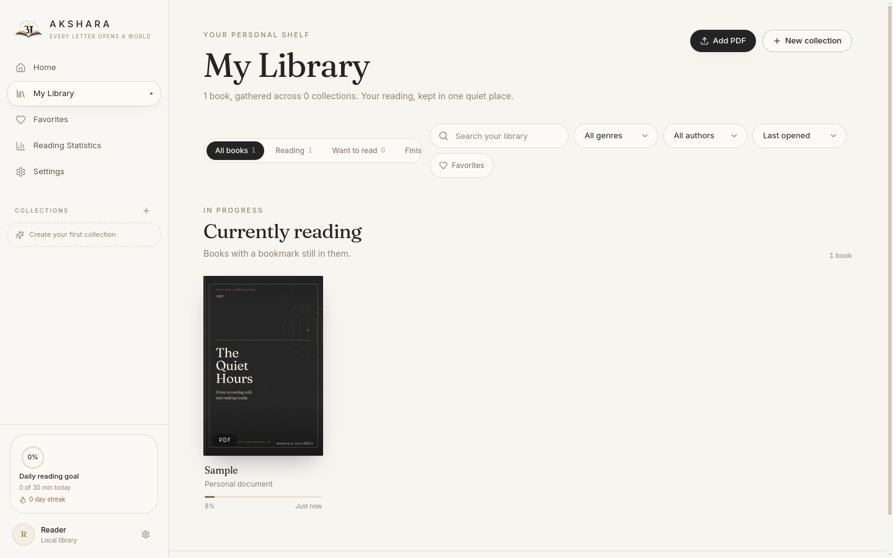

# Akshara (अक्षर)

**Every letter opens a new world.**

[](https://github.com/Peritoooo/akshara/actions/workflows/ci.yml)
[](https://github.com/Peritoooo/akshara/releases/latest)
[](LICENSE)


A local-first **desktop** PDF reader with a warm, editorial interface. Bring your own
books, read them in a quiet window that follows the app theme, and keep your place.
Optional accounts sync reading metadata between your computers — **PDF files never leave
the device that imported them.**

## Download

Grab the latest installer from [**Releases**](https://github.com/Peritoooo/akshara/releases/latest).

| Platform | File | Notes |
| --- | --- | --- |
| Linux (Debian/Ubuntu) | `akshara_*_amd64.deb` | `sudo apt install ./akshara_*_amd64.deb` |
| Linux (portable) | `Akshara-*-x86_64.AppImage` | Needs `libfuse2t64` on Ubuntu 24.04+ |
| Windows | `Akshara-*-setup.exe` | Unsigned; SmartScreen may warn |
| macOS | `Akshara-*-*.dmg` | Intel and Apple Silicon; unsigned, right-click → Open |

Builds are unsigned until signing certificates are configured. The Linux `.deb` and the
AppImage receive the same version.

## Screenshots

| Home | Library | Reader |
| --- | --- | --- |
|  |  |  |

## Why Akshara

- **Your books stay yours.** PDFs live in local storage; the account only carries
  metadata. No upload, no file server, no lock-in.
- **Built to be read.** The page blends into the theme, text is selectable, highlights
  are anchored to character offsets, and the toolbar disappears when you are reading.
- **Works offline.** The library, reader, notes, and progress work without a connection.
  Changes queue and sync when the network returns.
- **One account, several computers.** Progress, highlights, bookmarks, collections,
  sessions, and preferences follow you; the files do not.
- **Calm defaults.** Paper, sepia, and night reading themes; a focus mode; and a reader
  that follows the app theme unless you choose otherwise.

## Features

- Home, Library, Favorites, Reading Statistics, and Settings
- Import your own PDFs — no catalog, only the books you add; a soft cover is made from
  the first page
- Collections, reading statuses, favorites, and a daily reading goal
- Themed PDF reader with page/width fitting, zoom, bookmarks, and keyboard shortcuts
- Text selection with persistent highlights and notes
- Light, dark, and system application themes
- Optional email/password accounts with row-level security and offline-first sync
- Password reset through `akshara://` deep links, in-app password change, and permanent
  account deletion
- Automatic updates on Windows, macOS, and the Linux AppImage

## Privacy model

| Synced to your account | Stays on the device |
| --- | --- |
| Book metadata (title, author, cover thumbnail) | **The PDF file itself** |
| Library entries, status, progress | Device appearance theme |
| Reading positions | |
| Highlights, notes, bookmarks | |
| Collections and memberships | |
| Reading sessions | |
| Display name, daily goal, reader preferences | |

The Supabase `anon` key ships in the client by design; row-level security is what
protects each account. No `service_role` key is ever bundled.

## Getting started

Requirements: Node 20+ for development.

```bash
npm install
npm run app:start   # build + launch the desktop app
```

`npm run dev` runs the Vite UI in a browser for fast interface work. The shipped product
is the Electron app.

### Scripts

| Command | What it does |
| --- | --- |
| `npm run app:start` | Build and launch the desktop app |
| `npm run app:dist` | Build Linux `.deb` + AppImage into `release/` |
| `npm run app:dist:win` | Build the Windows installer |
| `npm run app:dist:mac` | Build the macOS dmg/zip |
| `npm run test:smoke` | Browser UI suite |
| `npm run test:e2e` | Real Electron shell suite |
| `npm test` | Both suites |
| `npx tsc -b` | Typecheck |

## Accounts and sync (optional)

Sync is off unless a Supabase project is configured, so a plain install works with zero
backend.

1. Create a project at [supabase.com](https://supabase.com).
2. Apply the schema. Either connect the project to this repository
   (**Project Settings → Integrations → GitHub**, deploy from `main`) or paste
   `supabase/migrations/*.sql` into the SQL Editor in filename order.
3. Copy **Project Settings → API → Project URL** and the **anon public** key into
   `.env.local`:

   ```bash
   VITE_SUPABASE_URL=https://your-project-ref.supabase.co
   VITE_SUPABASE_ANON_KEY=eyJhbGciOi...
   ```

4. Under **Authentication → URL Configuration**, set the Site URL to any valid
   `https://` address (for example `https://example.com`) and add these redirect URLs:

   - `akshara://auth/recovery` — password reset
   - `akshara://auth/callback` — email confirmation
   - `http://localhost:5173` — only for `npm run dev`

5. Email delivery: connect a transactional provider under
   **Authentication → Emails → SMTP Settings** (Resend, SendGrid, Mailgun, SES, or Gmail
   with an app password), then verify the sender domain. Until then, add accounts
   manually from **Authentication → Users** with **Auto Confirm User** enabled.

### How sync behaves

- The local store is the source of truth for the UI; writes go out about a second later.
- Offline changes queue locally and replay on reconnect, focus, or every 30 seconds.
- Conflicts are last-write-wins per record, and a record with an unsent local change
  always wins.
- Deletions travel as `deleted_at` tombstones so they do not reappear elsewhere.
- A book that arrived from the account without its PDF opens an **Attach the PDF**
  action; your place, highlights, and bookmarks are kept.

### Deleting an account

**Settings → Delete account** calls the `delete_account()` database function, which
removes the caller's rows and login in one transaction, then wipes this device's library,
sync state, and stored PDFs. It cannot be undone.

## Updates

- **Windows and Linux AppImage:** Akshara checks quietly after launch and downloads
  updates in the background. **Help → Check for Updates…** checks immediately and prompts
  to restart when a build is ready.
- **macOS:** the same flow, but installing an update requires a signed build. The
  current artifacts are unsigned, so macOS will report that it cannot update and point
  you at the release page; add signing/notarization credentials to enable it.
- **Linux `.deb`:** updates come from the package manager. **Help → Check for Updates…**
  opens the release page.
- Set `publish` in `electron-builder.yml` and push a `v*` tag; the release workflow
  builds all platforms and uploads installers plus `latest*.yml` metadata.

## Architecture

```text
src/                 React renderer (Vite, TypeScript, Tailwind, zustand)
  pages/Reader/      pdf.js reader, text layer, highlights
  lib/               Supabase client, sync engine, IndexedDB PDF store
  store/             Local library, settings, and session state
electron/
  main.cjs           Window, app:// protocol, deep links, menus, auto-update
  preload.cjs        Small context-isolated bridge
  authLink.cjs       akshara:// argument parsing
  updater.cjs        Which builds can self-update
supabase/migrations/ Schema, RLS policies, and the delete_account() RPC
tests/               Smoke suite (browser) and Electron E2E suite
```

The renderer is bundled by Vite. The Electron main process is bundled with esbuild into
`electron/main.bundle.cjs` so runtime dependencies (including `electron-updater`) are
included without shipping `node_modules`.

## Building installers

```bash
npm run app:dist       # Linux
npm run app:dist:win   # Windows
npm run app:dist:mac   # macOS
```

The tag workflow (`.github/workflows/release.yml`) builds Linux, Windows, and macOS on
their native runners and publishes the release. Signing is disabled by default; add
`CSC_LINK`, `CSC_KEY_PASSWORD`, and (for macOS) notarization credentials as repository
secrets to sign builds.

## Tests

```bash
npm test
```

- `tests/smoke.test.mjs` starts its own Vite server and drives headless Chrome through the
  main routes, import flow, reader, and narrow-window layout.
- `tests/electron.test.mjs` builds a throwaway local-only bundle, launches the real
  Electron shell with an isolated profile, and verifies the `app://akshara` origin, the
  preload bridge, local startup, PDF import, restart persistence, `akshara://` delivery,
  and the Help menu.

The Electron suite needs X11 or Wayland; use `xvfb-run --auto-servernum npm test` on a
headless machine.

## Reading data

- `akshara-library-v1` — entries, positions, collections, bookmarks, highlights, imported
  metadata, and sessions
- `akshara-settings-v1` — application and reader preferences
- `akshara-sync-v1` — per-account sync bookkeeping and the queue of unsent changes
- IndexedDB `akshara-files` — the PDF files themselves

Use **Settings → Export copy** for a JSON backup of metadata (not PDFs), or **Reset
library** to start fresh. On Linux the profile lives in `~/.config/akshara`.

## Database schema

`supabase/migrations/` holds `profiles`, `books`, `library_entries`, `reading_positions`,
`highlights`, `bookmarks`, `collections`, `collection_books`, and `reading_sessions`.
Every table carries a `user_id`, RLS limits each row to its owner, deletions are
tombstones, and `updated_at` is maintained by triggers.

## Contributing

See [CONTRIBUTING.md](CONTRIBUTING.md). Security issues: see [SECURITY.md](SECURITY.md).

## License

[MIT](LICENSE) © 2026 Peritooo
